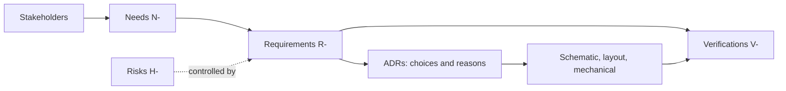

# Engineering baseline

How the board follows from what people want, before any schematic or layout is drawn. Everything here is a
**proposal** for review: the needs are the maintainers' assumptions until a real user conversation confirms them, and
the ADRs are `proposed`. Nothing has been built or measured.

## From needs to design

## Stakeholders

| Stakeholder | Wants | Needs |
| --- | --- | --- |
| Embedded engineer evaluating the sensor | A working sensor on the bench quickly | N-001, N-003, N-004 |
| Test engineer with a rig | A fixture-mountable board with a clear port | N-005 |
| Integrator building a product | A design and evidence they can reuse | N-002, N-006 |
| Maker or contract assembler | Files that build without questions | N-007 |
| Kokeb Labs driver maintainer | A known target for the driver's tests | N-001, N-008 |
| Firmware engineer without a host | An MCU on the board | N-009 (deferred) |

## Where each need lands

| Need | Requirements | Decisions | Risks controlled |
| --- | --- | --- | --- |
| N-001 Evaluate with the driver | R-001, R-002, R-003, R-004 | ADR-0001, ADR-0004 | H-001, H-004 |
| N-002 Know what is verified | R-005, R-017 | | H-005 |
| N-003 Connect without rework | R-006, R-007, R-013 | ADR-0002 | H-005 |
| N-004 Power from what I have | R-008, R-009, R-010 | ADR-0003 | H-001, H-002 |
| N-005 Mount it, port open | R-011, R-012, R-013 | ADR-0005 | H-003 |
| N-006 Reuse the design | R-014 | ADR-0002, ADR-0003 | |
| N-007 Build or buy it | R-015 | | |
| N-008 Known test target | R-016 | ADR-0004 | H-004 |
| N-009 MCU on the board | none yet | ADR-0001, ADR-0006 | |

The exact coverage is generated: `python3 tools/kb_check.py --report build`.

## Design intent for rev A

The circuit is the datasheet's connection diagrams (figures 25 and 26, via the driver's `hardware.yml`) plus the choices
above. This is intent, not a design: the schematic review decides.

| Block | Intent | Why |
| --- | --- | --- |
| Sensor | BMP581, 100 nF on VDD and on VDDIO next to the pins | Datasheet figures; R-001, R-003 |
| Power | 3.3 V direct or regulated from 5 V, by solder jumper; VDDIO tied to VDD, cuttable | ADR-0003 |
| Bus | I2C, 0x47 by default; solder jumpers move to 0x46 or SPI | ADR-0004, R-016 |
| Pull-ups | Jumpered on SCK and SDI; MISO pull-up for SPI only | ADR-0004 |
| Connectors | Eight-pin 2.54 mm header; two Qwiic connectors in parallel | ADR-0002 |
| Mechanical | Two M2.5 holes; at most 25.4 mm by 20.3 mm; port clear | ADR-0005 |

## Open questions

These change the baseline and need an answer from a person or a real user:

1. Does anyone want an MCU on the board, and if so which one (N-009, ADR-0006)?
2. Is a case wanted for the first release, or only the bare board (ADR-0005)?
3. Is a 5 V logic host common enough among users to justify a level shifter (ADR-0003)?
4. Where is the sensor port on the lid, and does Bosch publish venting or gel guidance? The datasheet does not (R-011).
5. Which hardware licence applies: see the organisation's ADR on the hardware licence.

## What an agent may do next

Draft the schematic and layout from this baseline, but only against it: every net and part traces to a requirement,
every choice not here becomes an ADR first, ERC and DRC must pass, and a person who did not draw it reviews the
schematic and the layout before any requirement is approved (`hardware/README.md`).
